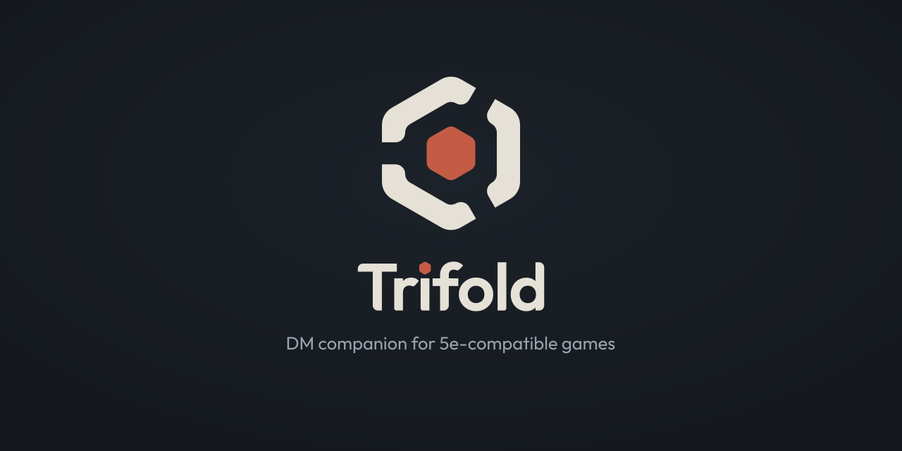

# Trifold



Trifold is a desktop app for Windows and macOS for Dungeon Masters running 5e-compatible games at a real table. It puts everything you reach for during a session in one window: a compendium, your campaign notes, encounters and a combat tracker, a second screen for the TV, your players' phones and the music.

It runs entirely on your computer. There are no accounts, no cloud services and no telemetry. Everything you make lives in an ordinary folder on your computer called the Library, so you can back it up, copy it or sync it however you like.

## What's inside

- **Compendium.** The SRD 5.2.1 (2024) and 5.1 rules are built in: monsters, spells, items, conditions and rules. Import your own compendium files and write homebrew alongside them.
- **Campaigns.** Party and NPC cards, notes in folders, a session log that fills itself in, and search across all of it.
- **Encounters and combat.** Build encounters against the 2024 XP budget, then run them: initiative, HP, conditions, concentration, and rolls straight from the stat block.
- **The TV.** Show title cards, images and maps, with tokens, fog of war and a movement ruler, on a second display.
- **Players' phones.** Players join from their phone's browser over your local network, follow the map and manage their own character.
- **Music.** Play your own files with crossfades and playlists, or play your phone's music through the laptop.

The [user guide](docs/USER-GUIDE.md) walks through all of it.

## Install

Download the build for your computer from the [releases page](../../releases).

- **Windows:** `Trifold-Setup-<version>-win-x64.exe` installs for your user only, so you don't need administrator rights. `Trifold-Portable-<version>-win-x64.exe` runs without installing. With the update check on (Settings › Updates), the installed version downloads new versions itself and installs them when you choose **Restart now**; the portable one sends you to the releases page. The builds aren't code-signed yet, so the first time you run one, Windows shows "Windows protected your PC". Click **More info**, then **Run anyway**.
- **macOS:** pick the `.dmg` for your Mac's chip (`arm64` for Apple Silicon, `x64` for Intel), open it and drag Trifold to Applications. The app isn't notarised yet, so the first launch says it can't be opened. Go to **System Settings → Privacy & Security**, find the message about Trifold and click **Open Anyway**.

On first launch Trifold creates its Library in `Documents/Trifold Library`; you can choose another folder in Settings. It also includes a short sample campaign, *The Lantern at Greyford*, so you have something to try things on.

## Learn more

- [User guide](docs/USER-GUIDE.md): how to use every part of the app.
- [Design](docs/DESIGN.md): what Trifold is for and how it fits together.
- [Data formats](docs/DATA-FORMATS.md): the files Trifold reads and writes, for anyone importing data or looking inside their Library.
- [All documentation](docs/README.md), including the guides for contributors and the [changelog](CHANGELOG.md).

## Building from source

You'll need Node 22 or newer and pnpm (`corepack enable` sets it up).

```
pnpm i              # install dependencies
pnpm fetch:content  # download the SRD and the icon set (once after cloning; needs network)
pnpm dev            # run the app with hot reload
pnpm test           # unit tests
pnpm typecheck      # type-check every package
pnpm lint           # ESLint and Prettier
pnpm smoke          # build, then drive the real app with Playwright
pnpm build          # package installers into dist/
```

The SRD text and icons aren't stored in the repo; `pnpm fetch:content` downloads them into `resources/`. Without them the app still runs, but the compendium is empty until you import something and tokens show initials instead of icons. `pnpm build` won't package an installer until they're there.

Each platform builds its own installer, so build on the kind of machine you're targeting. [Releasing](docs/RELEASING.md) covers the details.

A few things worth knowing:

- `pnpm i` also downloads Electron and the prebuilt SQLite module that matches it. If the app can't start or can't open its index, run `pnpm rebuild:native`.
- Some editor terminals set `ELECTRON_RUN_AS_NODE=1`, which stops Electron from opening windows. `pnpm dev` and the smoke test clear it for you; clear it yourself before starting a packaged build from one of those terminals.
- To start the app in development mode without a terminal, double-click `Trifold.cmd` (Windows) or `Trifold.command` (macOS) in the repo root.
- Keep your own compendium files out of the repo: name them `*.local.xml` or put them in `fixtures/local/`, both of which are ignored by git.

## Content and licensing

Trifold is free software, copyright © 2026 Ian duPont, licensed under the GNU General Public License version 3 or (at your option) any later version ([LICENSE](LICENSE)). Versions 0.3.0 to 0.4.5 were released under the MIT License. The Trifold name and logo are not covered by the licence: see [TRADEMARK.md](TRADEMARK.md). Contributions are welcome under the terms in [CONTRIBUTING.md](CONTRIBUTING.md). The app includes only System Reference Document content (CC BY 4.0), icons from game-icons.net (CC BY 3.0), the Outfit and IBM Plex Mono fonts (SIL OFL), this project's own text, and the sample campaign's maps by 2-Minute Tabletop (CC BY-NC 4.0, non-commercial and not covered by the GPL; see `samples/greyford/images/CREDITS.md`). The About page shows the full attribution.

Anything you import stays in your Library and is never sent anywhere.
